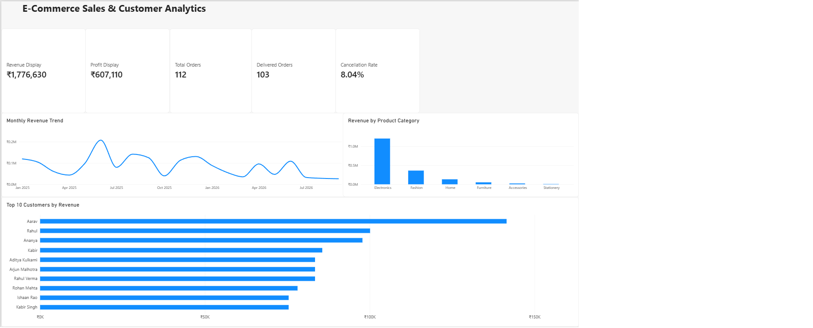

# E-Commerce Sales & Customer Analytics

**Tools:** MySQL · Power BI  
**Project type:** SQL analysis and business intelligence dashboard

## Project Overview

This portfolio project explores e-commerce orders, products, and customer data to understand sales performance, profitability, customer spending, and order cancellations. SQL was used to analyse the data, and Power BI was used to present the main metrics and trends in a dashboard.

> **Data note:** This project uses synthetic practice data created for learning and portfolio purposes. The results illustrate an analysis workflow and do not represent a real business.

## Dashboard

The dashboard includes KPI cards for revenue, profit, total orders, delivered orders, and cancellation rate, alongside charts for monthly revenue, revenue by product category, and the top 10 customers by revenue.

## Key Findings

| Metric | Result |
|---|---:|
| Revenue from delivered orders | ₹1,776,630 |
| Profit from delivered orders | ₹607,110 |
| Profit margin on delivered orders | 34.18% |
| Total orders | 112 |
| Delivered orders | 103 |
| Cancelled orders | 9 |
| Cancellation rate | 8.04% |
| Highest-revenue product category | Electronics |
| Highest-revenue customer | Aarav |

These findings are calculated from the synthetic dataset. Revenue and profit include delivered orders only; the cancellation rate uses cancelled orders divided by all orders.

## Business Questions

- How much revenue and profit did delivered orders generate?
- Which product categories generated the most revenue?
- Which customers contributed the most delivered revenue?
- How many orders were delivered or cancelled?
- How did revenue change month by month?

## SQL Analysis

The curated SQL file contains queries for:

- Validating row counts and summarising order statuses
- Calculating delivered revenue, profit, and profit margin
- Comparing revenue by product category
- Ranking the top 10 customers by delivered revenue
- Analysing customer order frequency
- Tracking monthly revenue
- Using a CTE and `RANK()` window function to rank customers
- Calculating the order cancellation rate
- Comparing order counts and item value by status

**SQL skills demonstrated:** `SELECT`, `WHERE`, `JOIN`, `GROUP BY`, `ORDER BY`, aggregate functions, `CASE`, subqueries, CTEs, and window functions.

## Project Files

- [`ecommerce_analysis_portfolio.sql`](ecommerce_analysis_portfolio.sql) — curated SQL analysis for the project.
- [`Ecommerce_Sales_Analytics.pbix`](Ecommerce_Sales_Analytics.pbix) — Power BI report file.
- [`screenshots/dashboard.png`](screenshots/dashboard.png) — dashboard preview.

## Validation

The delivered revenue, delivered profit, and cancellation-rate calculations were checked in SQL and compared with the corresponding Power BI metrics.
